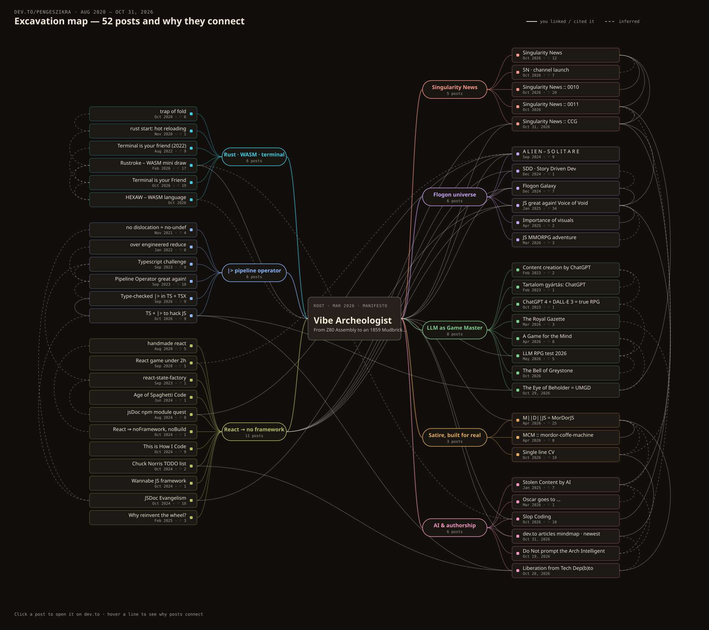

# dev.to/pengeszikra :: post map

An interactive mind map of every post on [dev.to/pengeszikra](https://dev.to/pengeszikra), from Aug 2020 to Oct 31, 2026, showing why each post connects to the others.

**[→ Open the interactive map](https://pengeszikra.github.io/devto-post-map/)**

- 51 posts in 8 threads, with 62 connections
- Solid line: the post links or cites the other one. Dashed line: inferred.
- Click a post, or move with ← ↑ → ↓, to see its 3-sentence summary and the reason for each connection.
- `index.html` is a single self-contained file: pure HTML, no build step.
